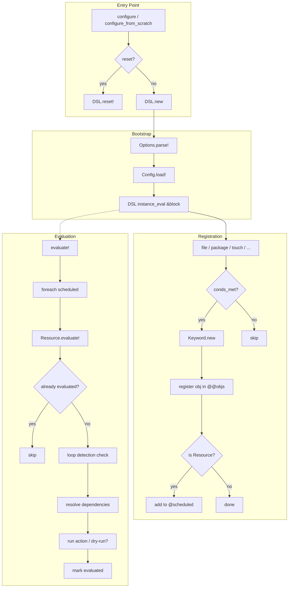
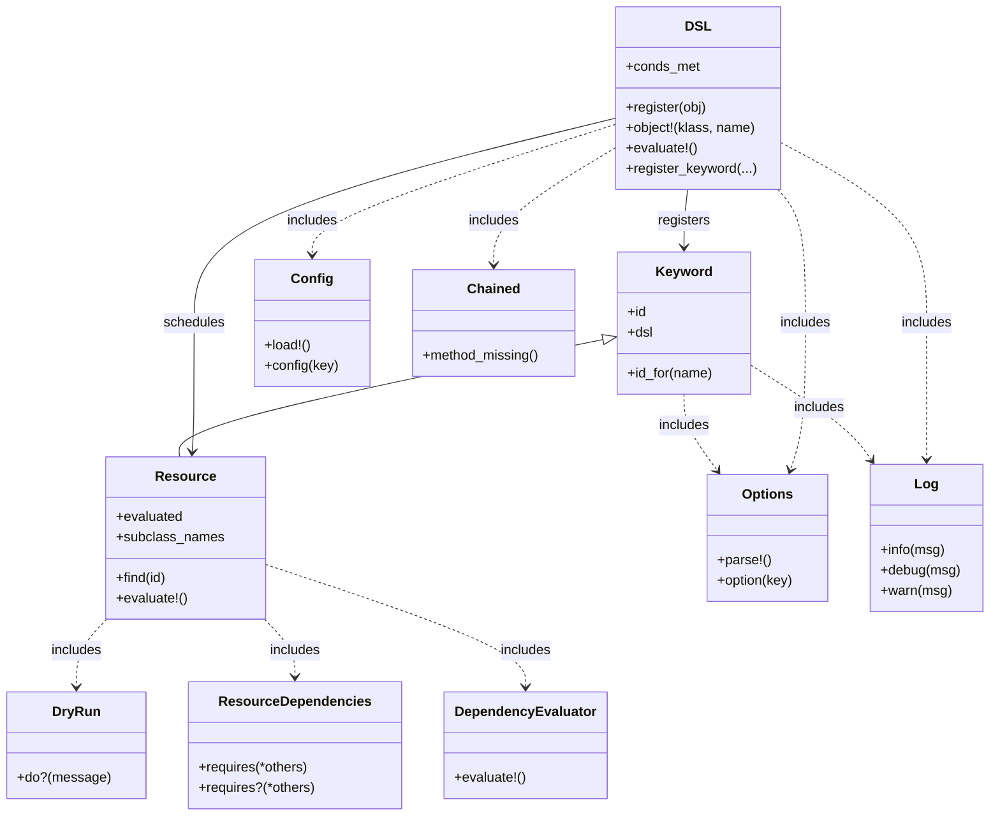

# RCM Project Flow

This diagram shows how a configuration run moves from the entry point through parsing, registration, dependency resolution, and finally execution.

## High-Level Flow

## Class & Mixin Relationships

## What Happens During a Run

1. **Entry** — `configure(reset: true)` or `configure(reset: false)` is called.
2. **Bootstrap** — `Options.parse!` reads CLI flags (`--debug`, `--dry`, `--hosts`) and `Config.load!` reads `config.toml`.
3. **DSL block** — The user’s configuration block is executed inside the DSL instance via `instance_eval`.
4. **Keyword creation** — Each keyword (`file`, `given`, `notify`, etc.) instantiates a `Keyword` or `Resource` subclass. Names are normalised via `Keyword.id_for`.
5. **Registration** — The generic `register(obj)` stores the object in the class-level `@@objs` hash keyed by `id`. If the object is a `Resource`, it is also appended to `@scheduled`.
6. **Conditionals** — `given { ... }` sets `@conds_met`. When false, subsequent keyword calls are skipped (no object created).
7. **Evaluation** — After the block finishes, `DSL#evaluate!` iterates `@scheduled`. Each `Resource#evaluate!`:
   - Checks for dependency loops.
   - Recursively evaluates its `requires` dependencies.
   - Executes the concrete action (file write, package install, etc.) unless `--dry` is active.
   - Marks itself as evaluated.
8. **Dry-run** — The `DryRun#do?` mixin wraps every side-effecting action. In dry mode it logs and returns without touching the system.
